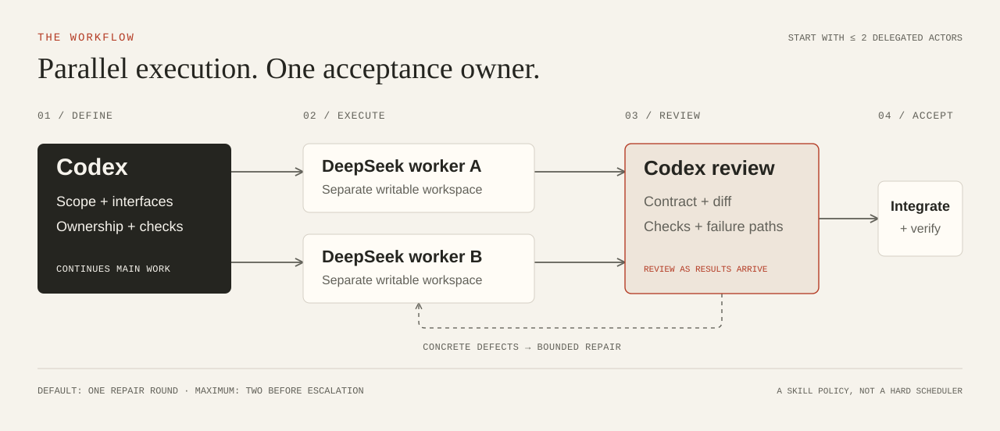

<h1 align="center">Codex DS Workers</h1>

<p align="center">
  Persistent DeepSeek workers for your Codex workflow.<br>
  <strong>Delegate independent work. Keep decisions and review in Codex.</strong>
</p>

<p align="center">
  <a href="#quick-start">Quick start</a> &nbsp;·&nbsp;
  <a href="docs/workflow.md">Workflow</a> &nbsp;·&nbsp;
  <a href="docs/evaluation.md">Evaluation</a> &nbsp;·&nbsp;
  <a href="README.zh-CN.md">中文</a>
</p>

<p align="center"><code>Node.js 24+</code> &nbsp; <code>Codex skill + MCP</code> &nbsp; <code>MIT</code></p>

<p align="center">
  
</p>

Give bounded tasks to persistent DeepSeek Harness workers while Codex handles the critical path. Review results as they arrive, repair concrete defects, and integrate accepted changes.

Use your existing **Codex login** and a **DeepSeek API key**. DS worker calls use separate API billing. Built on [dsh-subagent-mcp](https://github.com/dqtz5vpvj9-create/dsh-subagent-mcp) and [DeepSeek Harness](https://github.com/deepseek-ai/deepseek-harness).

## Quick start

You need **Node.js 24+, npm, Git**, and network access to GitHub and npm. The initial targets are macOS and Linux; macOS has been exercised with a real isolated install. See [installation details](docs/install.md) for platform coverage and existing-installation conflicts.

```bash
git clone https://github.com/Nahuyiur/codex-ds-workers.git
cd codex-ds-workers
node bin/codex-ds-workers.mjs setup
node bin/codex-ds-workers.mjs configure
node bin/codex-ds-workers.mjs doctor
```

`setup` installs the pinned bridge and SDK, registers the local MCP server, and installs the skill. It submits no model task. `configure` asks for the key privately in your terminal. Keep the key out of commands and chat messages, and keep the checkout after installation because its launcher and adapters remain in use.

Open a **new Codex chat** so the MCP tools and skill can load. Try a read-only task first:

```text
Use $dsh-subagent to have one DeepSeek worker trace this project's
configuration-loading path. Keep it read-only and return file references.
Check the evidence before accepting the answer.
```

**Expected result:** a worker ID you can continue and a result with file evidence. DS activity can appear as MCP results rather than a native GPT subagent card. If MCP tools have not loaded, the skill can use the installed CLI's `rpc` fallback.

## Give workers complete tasks

| Codex owns | DeepSeek executes |
|---|---|
| Scope, interfaces, risk, and model selection | Bounded code investigation with file evidence |
| Ambiguous or tightly coupled reasoning | Independent modules with explicit contracts |
| Review, integration, and final acceptance | Reproducers, test cases, and mechanical changes |

The parent chooses `low`, `high`, or `max` explicitly. Start with `low` for bounded execution, use `high` for reasoning-heavy work, and reserve `max` for a specific escalation. Difficult work can use a suitable native GPT worker, ordinarily no more capable than the parent when that comparison is known.

Start with **at most two delegated actors**. Give writable workers separate workspaces and fix shared interfaces before dispatch. The parent continues useful independent work and reviews early completions. A native relay and its DS worker count as two actors.

## Review before integration

1. Define acceptance commands, critical invariants, ownership, and protected inputs before dispatch.
2. Inspect the returned diff and checks against the contract. Check failure paths as well as successful output.
3. Consolidate defects into one repair round. Allow at most two before escalation or repartition.
4. Run integration checks after bringing accepted changes together.

> [!NOTE]
> The skill guides agent behavior; it is not a hard scheduler or a correctness guarantee. Keep project tests and parent review in the loop.

In the local evaluation, a repair passed all 38 frozen checks but still omitted a contract requirement. Parent diff review caught it; a second repair passed four additional contract checks. [Read the results and limits →](docs/evaluation.md)

## Try an isolated coding exercise

Ask Codex:

```text
Use $dsh-subagent for the onboarding exercise in examples/mini-project.
Make a temporary copy. Give text.py and stats.py to two DS low workers
in separate workspaces. Preserve README.md, tests/, and protected.json.
Review each diff, combine only the owned implementation files, and run
python3 verify.py. Report total elapsed time and each role's usage when
the provider exposes it. Do not publish or send anything externally.
```

This deliberately small example exercises handoffs and acceptance. It is not a speed benchmark; ordinary edits this small usually stay with the parent.

## Commands and maintenance

Run these commands from the checkout:

| Command | Purpose |
|---|---|
| `node bin/codex-ds-workers.mjs doctor` | Check local runtime health |
| `node bin/codex-ds-workers.mjs status` | Inspect service state |
| `node bin/codex-ds-workers.mjs start` | Start the background bridge, including after reboot |
| `node bin/codex-ds-workers.mjs rpc < request.json` | Call a bridge tool through JSON stdin |
| `node bin/codex-ds-workers.mjs uninstall` | Remove the owned integration; retain keys and history |

Same-session follow-ups keep their original model and effort; changing effort requires a new session with a concise handoff. On cancellation, interrupt the external DS worker and verify acknowledgement. Stopping a Codex turn alone does not establish that DS stopped.

[Installation and recovery](docs/install.md) · [Task and result contracts](skills/dsh-subagent/references/handoffs.md) · [Development checks](CONTRIBUTING.md)

## Credits and license

MIT. This repository adds the adaptive skill, portable bootstrap, and SDK compatibility adapter around a pinned upstream bridge. See [third-party notices](THIRD_PARTY_NOTICES.md). No API key, private conversation, or personal benchmark checkout is distributed.
