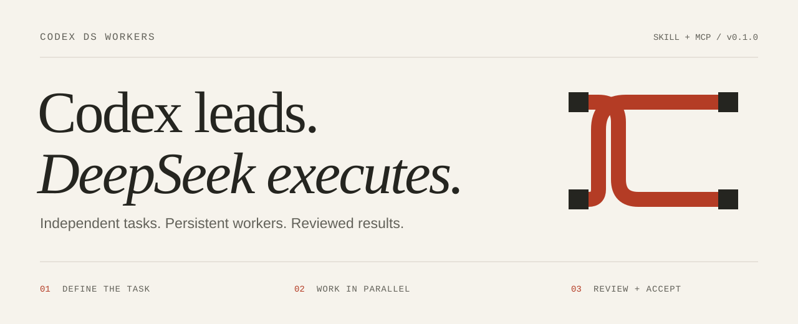
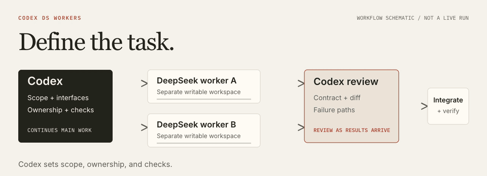

<p align="center">
  <picture>
    <source media="(prefers-color-scheme: dark)" srcset="docs/assets/hero-dark.svg">
    
  </picture>
</p>

<h1 align="center">Codex DS Workers</h1>

<p align="center">
  Persistent DeepSeek workers for your Codex workflow.<br>
  <strong>Delegate independent tasks. Keep decisions and acceptance in Codex.</strong>
</p>

<p align="center">
  <a href="#quick-start">Quick start</a> &nbsp; / &nbsp;
  <a href="#how-it-works">How it works</a> &nbsp; / &nbsp;
  <a href="docs/evaluation.md">Evaluation</a> &nbsp; / &nbsp;
  <a href="README.zh-CN.md">简体中文</a>
</p>

<p align="center">
  <a href="docs/install.md"></a>
  
  <a href="LICENSE"></a>
</p>

Give a worker a complete task, let Codex continue the main work, and review the result when it arrives. Workers keep their sessions for follow-up, so a concrete correction can return to the same worker with its context intact.

| Capability | What it gives you |
| :--- | :--- |
| **Persistent sessions** | Continue a worker's task without starting the conversation over. |
| **Isolated execution** | Assign explicit file ownership and separate writable workspaces before dispatch. |
| **Adaptive effort** | Choose `low`, `high`, or `max` to match a bounded task. |
| **Parent review** | Check the contract, actual diff, and failure paths before accepting changes. |

## Quick start

You need **Node.js 24+, npm, Git**, an existing **Codex login**, and a **DeepSeek API key**, with network access to GitHub and npm. DeepSeek calls use separate API billing.

The initial targets are macOS and Linux. macOS has a recorded isolated-install check; Linux needs its own host validation. [Platform coverage and installation details](docs/install.md).

### 1. Install and configure

```bash
git clone https://github.com/Nahuyiur/codex-ds-workers.git
cd codex-ds-workers
node bin/codex-ds-workers.mjs setup
node bin/codex-ds-workers.mjs configure
node bin/codex-ds-workers.mjs doctor
```

`setup` installs the pinned bridge and SDK, registers the local MCP server, and installs the skill. It submits no model task. `configure` prompts for the key privately in your terminal. Keep the key out of commands and chat messages.

Keep the checkout after installation: lifecycle commands still use its launcher. If you already have a `dsh_subagent` installation, setup preserves it and stops on conflicts. See [isolated profiles and recovery](docs/install.md#existing-installations).

### 2. Open a new Codex chat

A new chat lets the skill and MCP tools load. Start with a read-only task:

```text
Use $dsh-subagent to have one DeepSeek worker trace this project's
configuration-loading path. Keep it read-only and return file references.
Check the evidence before accepting the answer.
```

You should get a **worker ID you can continue** and a result with file evidence. Worker activity can appear as MCP results instead of a native GPT subagent card. If MCP tools have not loaded, the skill can use the installed CLI's `rpc` fallback.

## How it works

<p align="center">
  <picture>
    <source media="(prefers-reduced-motion: reduce) and (prefers-color-scheme: dark)" srcset="docs/assets/workflow-dark.svg">
    <source media="(prefers-reduced-motion: reduce)" srcset="docs/assets/workflow.svg">
    
  </picture>
</p>

<p align="center">
  <a href="docs/assets/workflow.svg">Static diagram</a> &nbsp; / &nbsp;
  <a href="docs/assets/workflow.mp4">MP4</a> &nbsp; / &nbsp;
  <a href="docs/workflow.md">Full workflow</a>
</p>

Codex owns scope, shared interfaces, risk, model selection, and final acceptance. DeepSeek handles bounded investigations, independent modules, reproducers, and mechanical changes. Keep ambiguous requirements and tightly coupled reasoning with the parent or a suitable native GPT worker.

Start with **at most two delegated actors**. Fix shared interfaces before dispatch, give writable workers separate workspaces, and review early completions while other independent work continues. A native relay and its DS worker count as two actors.

### Choose the effort

| Effort | Use it for |
| :--- | :--- |
| `low` | Bounded execution with clear inputs and checks. Start here. |
| `high` | A defined task that needs substantial reasoning. |
| `max` | A specific unresolved difficulty that merits escalation. |

The parent selects effort explicitly. A follow-up keeps the original model, effort, and preset; changing effort requires a new session with a concise handoff. These choices are a working policy, not a measured capability ranking.

### Review before integration

1. Define the deliverable, allowed files, protected inputs, and acceptance commands before dispatch.
2. Inspect the actual diff and meaningful checks, including failure and recovery paths.
3. Send one consolidated repair brief for concrete defects. Allow at most two repair rounds before escalation or repartition.
4. Integrate accepted changes and run the integration checks.

> [!NOTE]
> The skill guides agent behavior. It is not a hard scheduler or a correctness guarantee.

In the local evaluation, one repair passed all **38 frozen checks** but still missed a contract requirement. Parent diff review found the omission; a second repair passed **four additional contract checks**. The study shows a working review loop, with no evidence of a general speed advantage over native Luna. [Results, conditions, and limits](docs/evaluation.md).

<details>
<summary><strong>Try the two-worker coding exercise</strong></summary>

Use the included miniature Python project to practice isolated handoffs and acceptance:

```text
Use $dsh-subagent for the onboarding exercise in examples/mini-project.
Make a temporary copy. Give text.py and stats.py to two DS low workers
in separate workspaces. Preserve README.md, tests/, and protected.json.
Review each diff, combine only the owned implementation files, and run
python3 verify.py. Report total elapsed time and each role's usage when
the provider exposes it. Do not publish or send anything externally.
```

This deliberately small exercise checks the handoff and acceptance process. It is not a speed benchmark; ordinary edits this small usually stay with the parent.

[Exercise files and contract](examples/mini-project/README.md).

</details>

## Commands

Run these from the checkout:

| Command | Purpose |
| :--- | :--- |
| `node bin/codex-ds-workers.mjs doctor` | Check local runtime health. |
| `node bin/codex-ds-workers.mjs status` | Inspect service state. |
| `node bin/codex-ds-workers.mjs start` | Start the background bridge, including after reboot. |
| `node bin/codex-ds-workers.mjs rpc < request.json` | Call a bridge tool through JSON stdin. |
| `node bin/codex-ds-workers.mjs uninstall` | Remove the owned integration; retain keys and history. |

To cancel a task, ask Codex to call `dsh_interrupt` for the worker ID and verify the returned acknowledgement. Stopping a Codex turn alone does not establish that DS stopped. See [tool lifecycle and RPC fallback](skills/dsh-subagent/references/runtime.md#mcp-lifecycle).

Hosted CI is not enabled in this release. Run `npm test` locally; see [development checks](CONTRIBUTING.md).

## Documentation

| If you want to… | Read |
| :--- | :--- |
| Install, isolate a profile, or recover the runtime | [Installation guide](docs/install.md) |
| Understand ownership, concurrency, and completion | [Workflow guide](docs/workflow.md) |
| Write a complete task brief and review a result | [Task and result contracts](skills/dsh-subagent/references/handoffs.md) |
| Assess the local study and its limitations | [Evaluation](docs/evaluation.md) |
| Change the bootstrap or skill | [Contributing](CONTRIBUTING.md) |

## Credits and license

Built on [dsh-subagent-mcp](https://github.com/dqtz5vpvj9-create/dsh-subagent-mcp) and [DeepSeek Harness](https://github.com/deepseek-ai/deepseek-harness). This repository adds the adaptive skill, portable bootstrap, and SDK compatibility adapter around a pinned upstream bridge.

[MIT](LICENSE) · [Third-party notices](THIRD_PARTY_NOTICES.md). An independent integration, with no claimed endorsement by the upstream authors or model providers. No API keys, private conversations, or personal benchmark checkouts are distributed.
