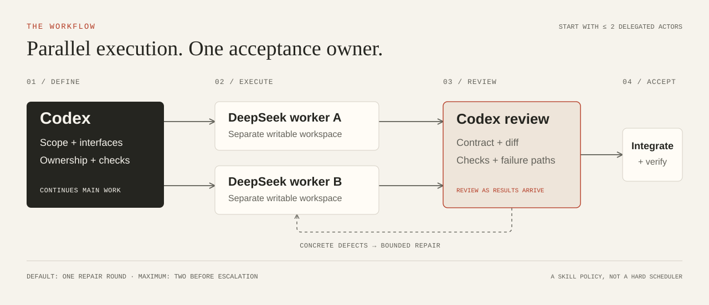

<p align="center">
  
</p>

# Codex DS Workers

**让 Codex 负责判断，让 DeepSeek 并行执行，结果由主 agent 验收。**

[English](README.md) · [协作流程](docs/workflow.md) · [实测与边界](docs/evaluation.md)

这套 skill 把适合独立完成的任务交给持久 DS worker。主 agent 负责拆分、关键难点、审查和集成，并在发现具体问题后进行有限轮次的修复。

你需要已有的 Codex 登录，以及一个 **DeepSeek API key**。DS worker 使用独立 API 计费。底层复用 [dsh-subagent-mcp](https://github.com/dqtz5vpvj9-create/dsh-subagent-mcp) 和 [DeepSeek Harness](https://github.com/deepseek-ai/deepseek-harness)。

## 开始使用

准备 Node.js 24+、npm、Git，以及 GitHub/npm 网络访问。初始面向 macOS 和 Linux；平台验证范围与旧安装冲突见[安装说明](docs/install.md)。

```bash
git clone https://github.com/Nahuyiur/codex-ds-workers.git
cd codex-ds-workers
node bin/codex-ds-workers.mjs setup
node bin/codex-ds-workers.mjs configure
node bin/codex-ds-workers.mjs doctor
```

`setup` 安装固定版本的 bridge/SDK、注册本地 MCP 并安装 skill，不提交模型任务。`configure` 在终端私密输入 key，不需要把 key 写进命令或聊天。安装后保留仓库目录，启动器和适配器仍会使用它。

打开一条新的 Codex 聊天，让工具和 skill 加载。先试一次只读调查：

```text
使用 $dsh-subagent，让一个 DeepSeek worker 只读追踪当前项目的配置加载路径，
返回文件位置和调用证据。你核对证据后再接受结果。
```

正常结果包含可继续追问的 worker ID 和代码证据。DS 活动通常显示为 MCP 工具结果，不一定是原生 GPT 子 agent 卡片。当前聊天没有加载 MCP 时，skill 可使用已安装 CLI 的 `rpc` 路径。

## 怎样分工

| 主 agent 保留 | 适合交给 DS |
|---|---|
| 范围、接口、风险判断 | 有明确范围的代码调查 |
| 模糊需求、强耦合难点 | 接口固定的独立模块 |
| 审查、接入、最终验收 | 复现案例、测试与机械修改 |

有界执行从 low 起步；已知推理密集任务用 high，max 留给具体难点的升级。特别困难的工作可以交给合适的 GPT 子 agent；能力关系明确时通常不超过主 agent，否则继承主模型。

初始最多两个委派执行者，写入工作区必须隔离。先固定公共接口，再启动并行分支。主 agent 同时推进独立主线，谁先完成就先验收。原生中转 agent 与其 DS worker 分别占一个名额。

## 怎样守住质量

交接前明确验收命令、关键不变量、允许修改的文件和受保护输入。完成后，主 agent 核对契约、diff 与实际检查，特别检查失败和恢复路径，再做集成验证。

默认集中修复一轮，最多两轮后升级模型、重新拆分或主 agent 接管。**这是协作指令，不是强制调度器，也不能保证绝对无 bug。** 实测里曾出现原有 38 项全通过、仍漏掉契约的情况；父 agent 查看 diff 后发现遗漏，第二轮修复通过了额外四项检查。

可以用 `examples/mini-project` 的临时副本练习两路执行与验收，具体提示词见 [English README](README.md#try-an-isolated-coding-exercise)。这个小例子用于检查接入，不用于证明加速。

## 维护与退出

```bash
node bin/codex-ds-workers.mjs status
node bin/codex-ds-workers.mjs rpc < request.json
node bin/codex-ds-workers.mjs uninstall
```

同会话追问保留原 model 和 effort；改变 effort 需要新会话与简短交接。停止任务时，需要显式中断外部 DS 并确认回执；停止 Codex 回合本身不能证明 DS 已停止。

安装、目录位置与故障恢复见[安装说明](docs/install.md)，原理见[协作流程](docs/workflow.md)，速度与质量证据见[评测记录](docs/evaluation.md)。目前没有证明这套流程普遍快于 Luna。

此版本暂未启用 GitHub 自动测试，可在仓库目录运行 `npm test` 做本地验证。

MIT 许可。底层来源与适配说明见 [THIRD_PARTY_NOTICES.md](THIRD_PARTY_NOTICES.md)。
